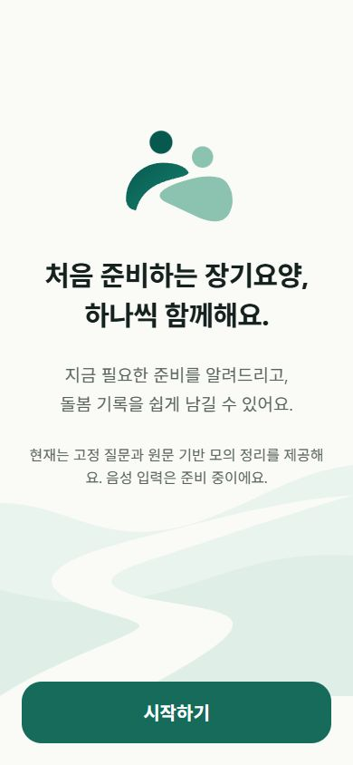
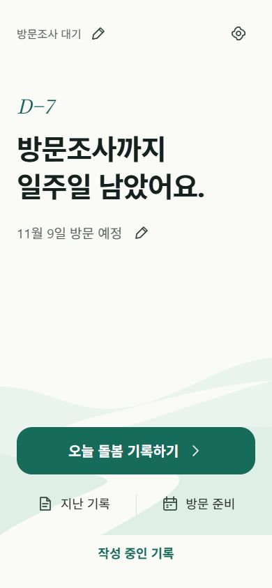
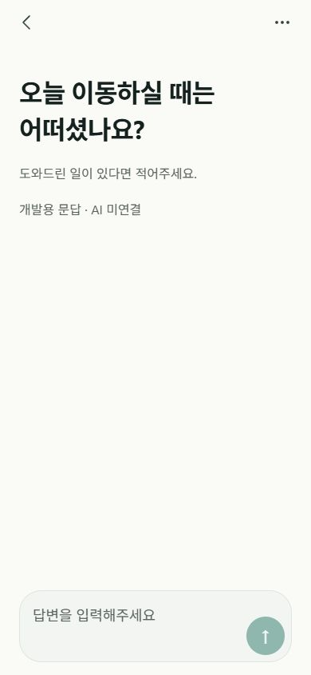

# 시안 디자인 적용 · 2026-11-02

## 실제 연결과 적용

| 실행 화면 | 실제 라우트/렌더링 | 시안과 비교한 변경 |
|---|---|---|
| 첫 소개 | src/app/index.tsx → features/onboarding/onboarding-screen.tsx | 두 사람이 이어지는 로고를 로컬 SVG로 재구성, 중앙 제목 30/44·본문 19/32, 하단 민트 곡선/길, 하단 시작 버튼 68 이상·모서리 22. 중복 브랜드 헤더 제거. |
| 홈 | src/app/home.tsx → features/home/home-screen.tsx | 보조 단계·수정과 우측 설정 아이콘, D-Day 28, 주요 제목 40/54, 일정 19/30, 곡선 배경, 하단 주 버튼과 아이콘이 있는 지난 기록/방문 준비 두 보조 진입점. 작성 중 기록 접근도 유지. |
| 문답 | src/app/records.tsx → features/records/records-screen.tsx → Interview | 상단은 뒤로가기·점 세 개 아이콘만, 질문 32/46을 위쪽에 배치. 기존 질문 내용에서 도움말만 작은 글씨로 분리. 하단 입력창·내부 원형 전송. 빈 제목의 접근성 헤딩 제거. |

공통 brand-visuals.tsx는 위 실제 화면들이 직접 import한다. 사용하지 않는 예시 컴포넌트만 수정한 작업이 아니다. 큰 글씨를 자동 축소하지 않으며 작은 화면은 스크롤로 대응한다. 버튼은 단색이며 시안의 그림자/그라데이션을 추가하지 않았다. 개발용 표시·기존 초안 경로·모의 문답 도움말은 필요한 정보로 유지한다.

## 실행·시각 검증

- 기존 8082 Metro `/status` HTTP 200 확인 후 작업했다. 작업 중 아이폰에서 일시적인 요청 시간 만료 보고가 있었으나 서버는 로컬/LAN 요청에 응답했고, 이후 사용자가 재실행 성공을 확인했다. 네트워크 시간 만료의 근본 원인을 단정하지 않는다.
- 사용자가 아이폰 홈에서 **민트색 곡선·큰 제목·톱니 아이콘의 새 디자인이 보임**을 확인했다. 따라서 최신 디자인 코드가 아이폰에 반영된 것은 확인됐다. 아이폰 세 화면을 직접 원격 캡처/비교한 것은 아니다.
- 웹 390×844 실제 실행 캡처를 첨부 시안과 대조하여 로고·곡선·글씨 위계·주 버튼/보조 링크·질문 위치·전송 영역을 확인했다.
- 320×568, 320×360 문답에서 질문 줄바꿈·긴 가상 답변·스크롤과 입력 초점 시 전송 버튼 접근을 확인했다. 실제 iOS 키보드·시스템 글자 확대는 별도 미검증이다.
- 가상 답변 384자 입력 → 뒤로가기 임시 저장 → 홈 이어쓰기 → 내용 복원 → 전송 → 더보기 조기 정리 → 특이사항 → 최종 확인·저장 → 캘린더 완료 표시를 확인했다.
- 최종 확인 실행 중 발견한 JSX 공백 텍스트 경고는 draft-review/typo-correction에서 수정했다. 새로고침 후 경고 없이 확인·저장이 동작했다.
- iOS 개발 번들 HTTP 200, 6,065,770바이트. 전체 번들에서 CarePath/BrandHero와 새 로컬 자산 포함을 확인했다.
- 타입 검사·기존 린트 통과. 관련 회귀 8개 통과. iOS·Android Hermes 실제 번들 생성 성공(신규 SVG 2개 포함).
- 데이터 모델/저장 키/기존 기록·단계·일정 초기화 없음. 의존성 설치·재설치 없음. CLI open.js 해시 `F63DA59BF7C928CEB8A44F3E250BBDFAFC046A287900C1D1A9B867A6160F4180` 유지. 실제 AI·음성 신규 연결 없음.

## 캡처

아래는 아이폰 캡처가 아닌 390×844 웹 실행 화면이다.

| 첫 소개 | 홈 | 문답 |
|---|---|---|
|  |  |  |

## 휴대폰 확인

1. Expo Go에서 현재 8082 프로젝트를 Reload한다. 홈의 곡선 배경·큰 제목·설정 아이콘을 확인한다.
2. 설정 → 첫 실행 흐름 테스트에서 로고가 있는 첫 소개를 확인한다. 테스트 종료 시 기존 데이터로 복귀한다.
3. 홈 → 오늘 돌봄 기록하기/이어서 작성하기에서 질문, 점 세 개 더보기, 입력창 내부 전송을 확인한다.
4. 키보드·긴 답변·시스템 큰 글자로 스크롤과 하단 Safe Area를 확인한다. 뒤로가기 후 내용 복원을 확인한다.

변경: assets/images/care-mark.svg, care-path.svg; src/components/brand-visuals.tsx; 첫 소개·홈·Interview; 공통 AppHeader·OverflowMenu; DraftReview/TypoCorrection 공백 수정; 기획·진행 문서와 캡처. 기능 로직이나 서버 연결 작업은 포함하지 않았다.
