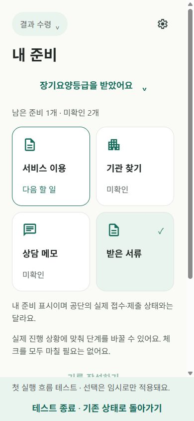

# 질문형 초기 진입·내 준비 카드 변경 · 2026-11-02

## 이번 변경

- 단계 목록 대신 신청 여부 → 방문조사 완료 여부 → 결과 수령 여부를 한 화면씩 묻는다. 단계 변경에서도 같은 흐름을 쓴다. 내부 ID는 유지하고 단계 표시 문구도 요청한 네 문장으로 통일했다.
- 단계가 파악되면 곧바로 카드로 가지 않는다. 1·3·4단계는 기존 콘텐츠를 기본 준비 우선으로 한 항목씩 확인한다. 아직/모름이면 해당 안내를 보여주고 다음으로 진행한다. 기존 해당 없음 항목은 다시 질문하지 않는다.
- 1단계: 신청 경험 → 필요한 경우 갱신/등급변경/이전 결과 후 신청 목적 → 짧은 준비 소개 → 신청 대상/방법/서류/소견서/문의 항목 중 해당 목록 → 내 준비.
- 2단계: 기존 일정 확인(선택·미정) → 돌봄 기록이 설명 때 참고가 되는 이유 → 기존 D-Day 홈. 이미 이 안내를 마친 재접속은 반복하지 않는다.
- 3단계: 소견서 상태 → 필요한 소견서 안내 → 결과 대기 중 준비 소개 → 결과 확인·기한·문의 준비 → 내 준비.
- 4단계: 받은 결과 → 짧은 다음 준비 소개 → 결과에 맞는 서류/서비스/기관/문의 또는 결과 사유/다음 절차 → 내 준비.
- 카드 기본 2열, 360 미만 또는 fontScale 1.3 이상에서는 1열이다. 고정 높이 없이 아이콘·짧은 제목·완료 배지, 남은/미확인 우선순위를 표시한다. 상세의 상태 수정에서 완료/취소/아직/모름/해당 없음을 바꾼다. 사각 체크박스와 취소선은 제거했다.

## 저장·루프 수정

- 기존 저장 형식 version 1과 키는 유지하면서 선택적 discovery, intros 필드를 추가했다. 단계 파악 답변/현재 질문과 단계별 안내의 현재 항목·답변·이전 위치·완료·신청 종류/결과 scope를 저장한다.
- 예전 setup 플래그나 신청 종류만으로 새 순차 안내를 완료했다고 판단하지 않는다. 완료 판정은 현재 scope의 intros 완료 값이다. 홈과 안내가 서로 다른 완료 조건을 쓰지 않는다.
- 홈의 자동 안내 이동과 이탈 방지는 현재 포커스 화면에서만 작동한다. 단계별 안내 컴포넌트도 stage/field 별로 분리했다. 뒤 화면의 가드와 이전 단계 화면 상태가 새 이동을 가로막는 문제를 수정했다.
- 뒤로 답변을 바꾸면 맞지 않는 후속 질문 답변만 정리한다. 기존 일지·체크·메모·서류 상태는 삭제하지 않는다. 신청 종류/결과 수정으로 새 안내가 필요하면 관련 안내부터 이어진다.
- 명확한 준비 완료 답변만 done, 아직은 todo, 모르거나 건너간 상태는 unknown이다. 안내의 다음 버튼은 준비 완료로 만들지 않는다. 별도 완료 버튼에서만 전체 초기 안내를 마친다.
- 개발용 첫 실행 테스트도 같은 흐름을 쓴다. 기존 정책대로 메모리 격리이며 테스트 종료/전체 재실행은 기존 실제 상태로 복귀한다. 일반 모드의 중단 위치는 기기에 영속 저장한다.

## 확인 결과

- 웹 실제 실행에서 네 경로의 질문 → 순차 안내 → 홈을 확인했다. 3·4단계에서 단계 선택으로 되돌아가는 현상 없이 종료됐다.
- 단계 파악의 두 번째 질문에서 Reload 후 동일 위치 복원, 소견서 안내 도중 Reload 후 위치 복원, 안내 완료 후 Reload하면 카드 직행을 확인했다.
- 첫 질문으로 뒤로 돌아가 신청 여부를 바꾸어 다른 분기로 이동했다. 실제 저장소와 분리한 테스트 종료 뒤 기존 오늘 일지와 준비 상태가 다시 표시됐다.
- 390×844 2열과 320×568 1열, 상세에서 남은 상태로 수정 후 카드 반영을 확인했다. 시스템 글자 확대·iOS 네이티브 제스처·실기기 네 경로는 직접 검증하지 않았다.
- 타입 검사·기존 린트 통과. 관련 테스트 12개 통과(흐름 4, 준비/보존 5, 공통 이탈 3). 마지막 해당 없음 필터 변경은 영향받는 흐름 4개만 재검사했다. iOS Hermes 번들 생성 성공.
- 콘텐츠 재조사·새 의존성·데이터 초기화·스플래시 변경·일지 개편·탭 추가 없음. CLI open.js SHA256 기존 값 유지.

변경 파일: features/start/stage-screen.tsx, features/trial/stages.ts, features/home/home-screen.tsx, features/preparation/{model,intro-flow,intro-screen,questions-screen,checklist,detail-screen,content}, components/navigation/use-safe-exit.ts, app/guide.tsx, tests/guided-intro.test.cjs, preparation-policy.test.cjs, 기획·진행 문서.

휴대폰: 전체 Reload → 설정의 첫 실행 흐름 테스트에서 네 분기 확인 → 테스트 종료. 일반 모드의 단계 변경/진행 중 안내에서 중단·재실행해 같은 위치로 돌아오는지 확인한다. 테스트 모드 재실행은 저장 복원 시험과 구분한다.

